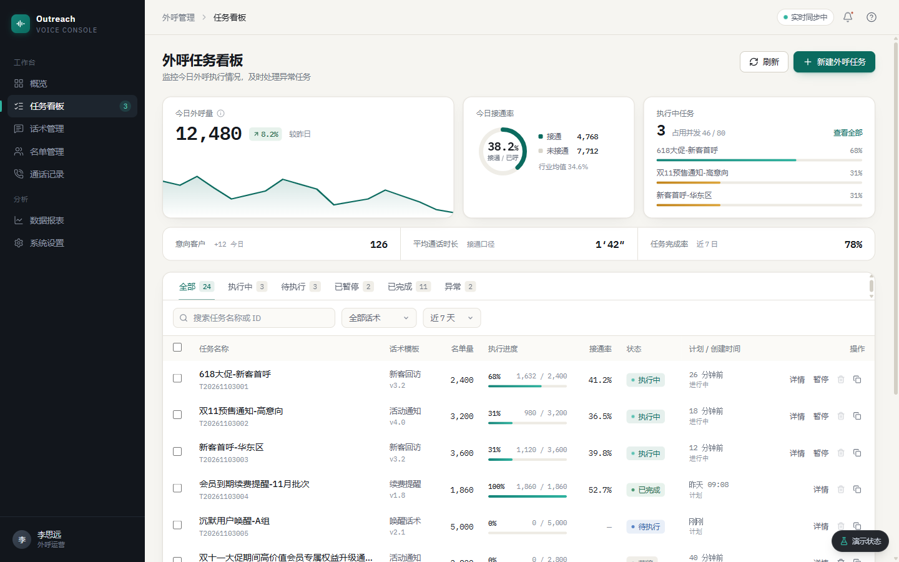

# 智能语音外呼任务看板 · Outreach Console

面向外呼运营的批量任务控制台：**创建任务 → 监控进度 → 处置异常 → 查看结果**。
前端 Vue 3 + TypeScript，后端 Spring Boot 3（可选启动），默认以 mock 数据运行，开箱即用。

**代码仓库**：https://github.com/ppIsCoding/outreach-console
**在线预览**：https://outreach-console-tawny.vercel.app （无需后端，打开即用）



---

## 快速开始（30 秒）

> 无需数据库、无需后端，前端自带 mock 数据。

```bash
cd web
npm install
npm run dev
# 打开 http://localhost:5173
```

Node.js ≥ 20。首次安装依赖约 1–2 分钟。

### 全栈启动（可选）

```bash
# 终端 1：后端（H2 文件库，零配置）
cd server
mvn spring-boot:run          # http://localhost:8080

# 终端 2：前端（走真实接口）
cd web
npm run dev:api              # http://localhost:5173
```

后端接口文档：`http://localhost:8080/swagger-ui/index.html`

---

## 功能清单

**概览**

- 今日外呼量（含环比 + 近 7 日趋势）、接通率环形图、执行中任务实时进度
- 意向客户 / 平均通话时长 / 任务完成率

**任务列表**

- 6 个状态 Tab，计数由后端聚合，不随分页变化
- 关键词（300ms 防抖）+ 话术 + 时间范围组合筛选，**条件全部同步 URL**
- 数值列右对齐 + 等宽数字；超长任务名省略并带 Tooltip
- 当前页多选（筛选 / 翻页后自动清空）、批量暂停 / 终止、分页（10 / 20 / 50）
- 行内操作按状态机动态启用，禁用时给出原因

**新建任务**

- 右侧抽屉 + 3 步向导：基础信息 → 呼叫对象 → 外呼策略
- 字段级校验、错误定位到首个字段、`aria-invalid`、提交防重复
- 实时预估耗时与风险提示

**任务详情**

- 通话结果分布、意向等级分布（演示数据按已呼量归一化）、状态流转时间线
- 快捷操作：暂停 / 恢复 / 终止 / 复制

**实时**

- 执行中任务进度通过 WebSocket 推送（mock 模式用本地定时器模拟）
- 断线指数退避重连

---

## 状态完整性

右下角「演示状态」可一键切换，供评审在 5 秒内验证全部状态（仅 mock 模式可见）：

| 状态 | 表现 |
|---|---|
| 正常 | 24 条种子数据，覆盖全部状态与边界样本 |
| 加载中 | 骨架屏，与真实布局同高，无跳动 |
| 空数据 | 插画 + 新建引导，概览同步归零 |
| 筛选空 | 独立文案 + 「清除筛选」 |
| 请求失败 | 区块内错误卡 + 错误码 + 单独重试，概览数据保留 |
| 无权限 | 403 空状态，概览降级为 `--` |

此外还处理了：乐观更新失败回滚、状态冲突 409、分页越界回退、提交中禁用、删除二次确认。

---

## 技术栈

| 层 | 选型 |
|---|---|
| 框架 | Vue 3.5 `<script setup>` + TypeScript |
| 构建 | Vite 8 |
| 样式 | Tailwind CSS 4 + CSS 变量设计 token |
| 组件 | reka-ui（无皮肤、自带焦点陷阱与 ARIA） |
| 服务端状态 | TanStack Query（缓存 / 重试 / 乐观更新） |
| 客户端状态 | Pinia |
| 后端 | Spring Boot 3.5 + Java 21 + MyBatis-Plus + H2 / MySQL |
| 实时 | 原生 WebSocket |
| 工程化 | ESLint 10 + Prettier + `tsc` 类型检查 |

---

## 目录结构

```
outreach-console/
├── web/                    前端
│   ├── src/api/            接口层（http / mock 双适配）
│   ├── src/composables/    筛选、查询、乐观更新、WebSocket
│   ├── src/components/     layout / dashboard / task / ui / dev
│   ├── src/styles/         设计 token
│   └── src/views/          页面
├── server/                 Spring Boot 后端（可独立运行）
├── design/prototype.html   高保真静态原型（无需构建，直接打开）
├── docs/
│   ├── 01-需求理解.md
│   ├── 02-技术方案.md
│   ├── 03-数据模型与接口.md
│   ├── 04-设计评审.md       第三方评审结论与修复清单
│   ├── 05-设计决策记录.md   Skill 评审的采纳 / 不采纳依据
│   ├── 06-AI协作记录.md     AI 生成 → 审查 → 修复的真实过程
│   ├── 07-开发进度.md       完成度、验证记录与待办
│   ├── 08-提交材料.md       提交清单、JD 对照、邮件正文、演示分镜
│   └── screenshots/
└── README.md
```

---

## 设计说明

- **方向**：数据密集型运营控制台，克制、精确、信息优先
- **配色**：暖白画布 `#F6F5F1` + 深青主色 `#0B6B5F`，仅状态标签使用彩色
- **字体**：IBM Plex Sans / Mono（自托管，不依赖 Google Fonts），数字统一等宽对齐
- **对比度**：正文与关键标签均 ≥ 4.5:1，详见 `docs/05-设计决策记录.md`
- **动效**：仅保留状态变化（进度 500ms、抽屉 260ms），尊重 `prefers-reduced-motion`

设计稿：`design/prototype.html`（可直接双击打开，含可点击交互）

---

## AI 协作

本项目按「AI 生成 + 人工审查」流程开发，真实过程记录见 `docs/06-AI协作记录.md`，包括：

- 哪些部分适合交给 AI（脚手架、CRUD、样式初稿、测试用例）
- 哪些必须人工把关（状态机、竞态、可访问性、接口契约）
- 5 个「AI 产出有问题 → 发现 → 修复」的具体案例（带前后对比）

---

## 部署（在线预览）

前端已内置部署配置，根目录选 `web` 即可，无需额外设置：

**Vercel**

```bash
cd web
npx vercel --prod
# 或：Vercel 控制台导入仓库 → Root Directory 填 web → 自动识别 vercel.json
```

**Netlify**

```bash
cd web
npx netlify deploy --prod --dir=dist
# 或：导入仓库 → Base directory 填 web → 自动读取 netlify.toml
```

> 生产构建固定 `VITE_API_MODE=mock`（见 `.env.production`），
> 因此在线预览不需要后端也能完整演示，包括「演示状态」切换。

---

## 已知限制

| 项 | 说明 |
|---|---|
| mock 为默认模式 | 前端演示不依赖后端；`npm run dev:api` 走真实接口（已验证列表 / 统计 / 创建任务） |
| 话术版本号 | 后端 DTO 暂未返回，列表中版本号为空 |
| MySQL 未实测 | `application-mysql.yml` 已提供，本机无 MySQL 实例，仅验证 H2 |
| 后端重启重置种子数据 | `spring.sql.init.mode=always`，联调时新建任务会消失 |
| 真实拨号未接入 | 需运营商线路与资质，超出题目范围 |

---

## 脚本

```bash
npm run dev        # mock 模式开发
npm run dev:api    # 连接本地 Spring Boot
npm run test       # Vitest（25 个用例）
npm run build      # 类型检查 + 生产构建
npm run lint       # ESLint
npm run format     # Prettier
```
